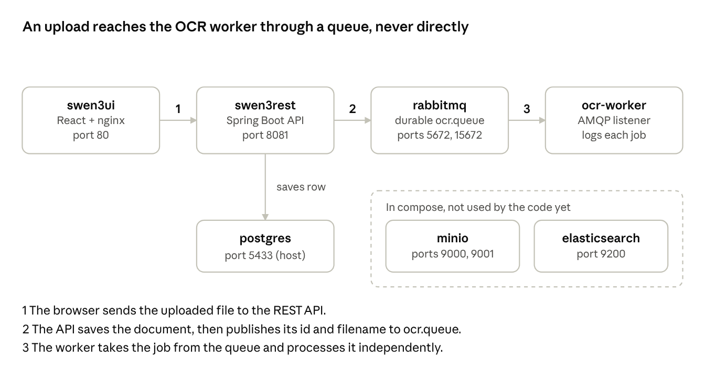

# SWEN3 Document Management

[](https://github.com/lamthimateo/swen3_lamthi_mehmeti_markus/actions/workflows/ci.yml)

A document management system (Paperless-style) built for the SWEN3 course at FH Technikum Wien. Users upload PDFs, browse and label them, and search inside their contents: an uploaded PDF is stored in MinIO, a background worker recognises its text (OCR) and the text is indexed in Elasticsearch.

Detailed notes on design decisions, testing and the team workflow are in [`documentation/protocol.md`](documentation/protocol.md).

## Architecture



| Component | Technology | Job |
| --- | --- | --- |
| `swen3ui` | React (Vite), nginx | Upload, list, label and delete documents; search page. nginx also proxies `/api/` to the REST service. |
| `swen3rest` | Spring Boot 4.1.1, Java 25 | REST API in layers: controller, service (interfaces), repository (Spring Data JPA). DTO records and MapStruct mappers. |
| `ocr-worker` | Spring Boot, Ghostscript, Tesseract | Takes OCR jobs from the queue, fetches the PDF from MinIO, extracts the text, hands it to the indexing step. |
| PostgreSQL 17 | | Metadata of documents and labels. |
| RabbitMQ 4 | | Queues `ocr.queue` (REST to worker) and `index.queue` (OCR step to indexing step). |
| MinIO | | Object storage for the original PDFs. |
| Elasticsearch 8 | | Full-text index of the OCR results. |

**What happens on upload**

1. `POST /api/documents`: the file is validated (not empty) and the service saves the document row.
2. The service stores the PDF in MinIO (`documents/<id>/<filename>`) and publishes an `OcrJobMessage` to `ocr.queue`. If either step fails, the row is rolled back, so there is no document without a file and a job. The API answers `201 Created`.
3. The worker takes the job, downloads the PDF, renders each page with Ghostscript, recognises it with Tesseract (English and German) and sends the text to `index.queue`.
4. The indexing step stores the text in Elasticsearch under the document id.
5. `GET /api/documents/search?q=term` asks Elasticsearch, then loads the matching documents from the database.

The REST API never calls the worker directly, so a slow or failing OCR job cannot affect uploads.

## How to run

Requires Docker with Docker Compose. Nothing else has to be installed.

```bash
docker compose up --build
```

The first start downloads images and builds three services, so it takes a few minutes. Elasticsearch needs about half a minute before the worker and the API start.

| Service | URL / port | Notes |
| --- | --- | --- |
| Web UI | http://localhost | |
| REST API | http://localhost:8081/api/documents | |
| RabbitMQ management | http://localhost:15672 | login `guest` / `guest` |
| MinIO console | http://localhost:9001 | login `minioadmin` / `minioadmin` |
| MinIO API | 9000 | |
| Elasticsearch | http://localhost:9200 | |
| PostgreSQL | localhost:5433 | database `swen3db`, user `postgres` |
| RabbitMQ (AMQP) | 5672 | |

**Try it:** open http://localhost, upload a PDF that contains the word "Hello", wait a few seconds and search for `Hello`. The progress of the document can be followed in the logs:

```bash
docker logs -f swen3-ocr-worker     # Received OCR job -> OCR finished -> Indexed document
docker logs swen3rest               # Stored ... in MinIO, Published OCR job ...
```

Stop everything with `docker compose down` (add `-v` to delete the stored data as well).

## API

| Method and path | Description |
| --- | --- |
| `POST /api/documents` | Upload a file (multipart field `file`, up to 50 MB). `201` with a `Location` header. |
| `GET /api/documents?page=&size=&sort=` | Paginated list (default 20, maximum 100), sortable by `id`, `filename`, `uploadDate`. |
| `GET /api/documents/{id}` | One document. |
| `GET /api/documents/search?q=` | Full-text search, best match first. |
| `DELETE /api/documents/{id}` | Delete the document, its label links and its file. |
| `GET /api/labels`, `POST /api/labels?name=` | List and create labels. |
| `GET/POST /api/documents/{id}/labels`, `DELETE /api/documents/{id}/labels/{labelId}` | Labels of a document. |

Errors are returned as RFC 9457 problem details (`type`, `title`, `status`, `detail`, `instance`): `400` invalid request, `404` not found, `409` conflict, `503` when MinIO or Elasticsearch is unreachable.

## Configuration

Defaults in each service's `application.yaml` work for running a service on the host next to the containers. `docker-compose.yml` overrides the host names with environment variables (`SPRING_RABBITMQ_HOST`, `APP_MINIO_ENDPOINT`, `APP_ELASTICSEARCH_URL`, ...), because inside Compose `localhost` is the container itself. The credentials in the compose file are development defaults.

## Testing strategy

All tests run without Docker or any external service, locally and in CI.

| Level | What is tested | Tools |
| --- | --- | --- |
| Repository | queries and constraints against an in-memory H2 database | `@DataJpaTest` |
| Service | business rules: upload flow and rollback paths, sorting rules, delete order, search | JUnit 5, Mockito |
| Mapper | entity to DTO mapping | JUnit 5 |
| Controller | HTTP mapping, validation, status codes, error bodies, CORS | `@WebMvcTest`, MockMvc |
| Messaging, storage, search clients | queue name and payload, retry and reject behaviour, MinIO and Elasticsearch calls and failures | Mockito, local fake HTTP server |
| OCR engine | page order, command arguments, clean-up of temporary files, failures | JUnit 5 with a fake command runner |
| UI | lint and production build (no UI tests yet) | ESLint, Vite |

Run the tests of one service with `./mvnw verify` inside `swen3rest` or `ocr-worker`. The GitHub Actions workflow (`.github/workflows/ci.yml`) runs both services' tests, lints and builds the UI, and then builds all Docker images, on every push and pull request.

Not covered: an end-to-end test of upload, queue, OCR and search with all containers running; this is checked by hand (see "Try it").

## Development workflow

Work happens on feature branches that reach `main` through pull requests. Tasks are tracked in a [Notion workspace](https://app.notion.com/p/SWEN-3-Project-3db95a51409480b4a2b5f74d70324ced?source=copy_link) with a sprint tracker and a checklist per sprint.

## Lessons learned

| Problem | Cause | Fix |
| --- | --- | --- |
| Docker build of `swen3rest` failed with "Child module /build/messaging does not exist" | A generated `pom.xml` declared a Maven module the Dockerfile never copies | Messaging code is a package of the service, not a module |
| Worker crashed with `NoClassDefFoundError: tools/jackson/core/JacksonException` | The AMQP starter does not bring Jackson, which the JSON message converter needs | Added `spring-boot-starter-jackson` |
| `POST /api/documents` returned 500 (`AmqpConnectException`) | The container tried `localhost:5672`, which is itself | Host name set through `SPRING_RABBITMQ_HOST` |
| Failed uploads still created documents | The row was saved before the side effects were done | Upload is `@Transactional`; storing or queueing failures roll it back, and a stored file is removed again |
| Docker build failed although tests were skipped | `-DskipTests` still compiles the test sources, so a test referring to missing classes breaks the image build | Keep tests and the code they test in the same commit |

Takeaways:

- Read the first `Caused by:` line of a stack trace; the visible error is often a wrapper.
- Inside Docker Compose, use service names as host names and set them through environment variables.
- Put external systems behind small interfaces (`FileStorage`, `OcrEngine`, `DocumentIndexer`, `DocumentSearchClient`, `CommandRunner`): the logic can then be tested without MinIO, Tesseract or Elasticsearch.
- Retrying a message that can never succeed only wastes work: missing files and OCR errors are rejected at once, temporary failures are retried a few times.
- A queue separates the services, but sender and receiver must agree on the message format; the message record is currently duplicated in both projects.

## Known limitations

- The job is published before the database transaction commits; the usual fix (publish after commit, or an outbox) is not implemented.
- A message that keeps failing is dropped after three attempts; there is no dead-letter queue yet.
- Entries of deleted documents stay in the search index; they are filtered out when searching.
- Search matches whole words of the text and the filename (no fuzzy matching, no highlighting).
